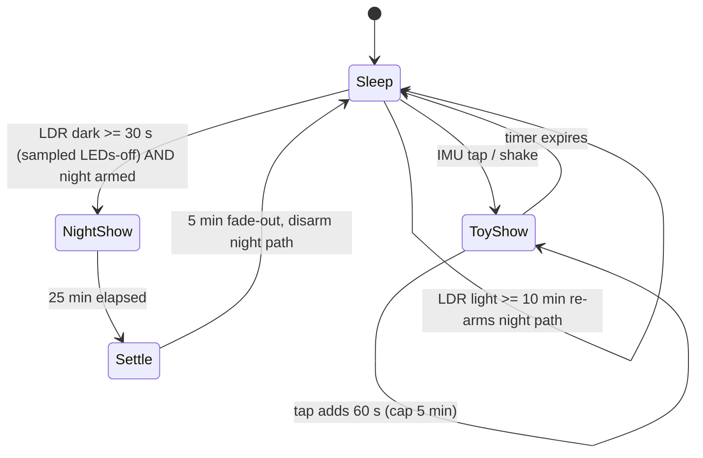

# Design Decision: Glow-Cycle Timing and Wake Behavior

**Asset:** [6080007](./6080007.md)

## Decision
How long should the jar glow after each kind of wake, and should a second shake extend an active show? This resolves the [Spec-2](./Spec-2.md) open item "exact glow-cycle duration and whether a second shake while active should extend it." It also defines the night-light vs. toy behavior required by [MuSCoW](../Define/MuSCoW.md) item 21.

## Criteria
- **Item 21, night light AND toy (Must):** the jar comes alive on its own when the room goes dark, *and* wakes on demand.
- **Battery life (item 2 Must, item 19 Should):** active time is the dominant draw once standby is tuned ([DD-3 model](./DD-3-Power-Source.md#reference-use-profile-and-battery-model)).
- **Item 12, maximum lasting joy (Should):** long enough to enjoy and to show people; a satisfying ending rather than an abrupt cut-off.
- **Item 23, quiet mode is a Won't:** "slightly annoying is fun," so no parental schedule, but the jar must not run all night and kill the battery.
- **Stability:** the LDR must not be fooled by the jar's own light ([DD-1](./DD-1-Trigger-Mechanism.md)).
- **Item 16, schedule (Must):** simple enough to firmware before Christmas.

## Discussion / Research
**The Rev A behavior was effectively "all night."** Spec-2 Rev A ran 30-60 s windows and kept going "while still dark," which in a dark bedroom never ends.
- That gives ~18 days per charge on 500 mAh.
- It risks the LDR reading the jar's own glow as light (start/stop oscillation).

**A dusk "show" with a natural ending.** Real firefly displays are a dusk event. A kid usually falls asleep within ~20-30 min. A 30-min show whose last 5 min "settle down" (fewer, slower, dimmer flashes, then dark) feels intentional, like the fireflies going to sleep.

**Re-arm rule.** After a night show ends, the LDR path stays disarmed until the room has been **light for ≥10 min**, which in practice means the next morning or evening. This stops a dark room from restarting the show every few minutes. The accelerometer path stays armed all night, so a kid can always wake the fireflies, which is part of the fun under item 23.

**Toy timing.** Each shake or tap gives a 60 s show. Another tap during a show adds 60 s, capped at 5 min, so a showing-off session isn't cut short. Double-tap is reserved for mode change ([DD-9](./DD-9-Glow-Pattern.md)).

**Battery by night-show length (XIAO Sense, 6 LEDs, 5 x 60 s toy wakes/day, 500 mAh):**
| Night show length | Active min/day | mAh/day | Days per charge |
|---|---|---|---|
| None (toy only) | 5 | 0.61 | ~740 |
| 30 min | 35 | 2.10 | ~214 |
| 60 min | 65 | 3.59 | ~125 |
| All night (~8 h) | 485 | 24.45 | ~18 |

**State machine (for Develop):**

## Final Decision
- **Night show:** starts after ≥30 s of darkness (LDR sampled with LEDs off). It runs **30 min total**: 25 min normal display, then a 5 min "settling down" fade. Afterward the night path is disarmed until the room has been light for ≥10 min.
- **Toy show:** **60 s per shake/tap**. Each additional tap during a show adds 60 s, up to **5 min** maximum. Shake and tap always work, day or night.
- Durations are firmware constants, so they can be tuned after Destroy or by a reprogramming cousin (item 22).

## Explanation
- **Item 21:** automatic night light plus on-demand toy, both always available.
- **Battery:** ~214 days/charge, versus ~18 days for the Rev A "while dark" behavior.
- **Item 12:** the settling-down ending gives the night show a story arc, and stacking taps lets a kid keep showing people.
- **Item 23:** no quiet mode. A 3 a.m. bump that wakes the fireflies is accepted as part of the charm.
- **Stability:** LEDs-off LDR sampling plus the re-arm rule removes self-triggering.

## Options Summary
| Forced Rank | Option | Est. Cost / Unit | Cost Implication | Battery Life Implication | Joy (1-5) | Upside | Downside |
|---|---|---|---|---|---|---|---|
| 1 | Night show 30 min with 5 min settle-down, re-arm after light; toy 60 s per tap, stackable to 5 min | $0 (firmware) | None | ~214 days/charge | 5 | Night-light story arc; long battery; can always show people | Slightly more firmware state than a fixed timer |
| 2 | Same, but night show 60 min | $0 | None | ~125 days/charge (−89 days) | 4 | Longer night light for slow sleepers | Battery life nearly halved |
| 3 | Night show runs all night until light; toy 60 s | $0 | None | ~18 days/charge | 3 | True all-night night light | Recharge every ~2.5 weeks; kids will stop charging it |
| 4 | Rev A: 30-60 s windows, continue while dark | $0 | None | ~18 days/charge (effectively all night) plus LDR self-trigger risk | 2 | Simple loop | Unstable around the LDR threshold; same drain as rank 3 |
| 5 | Toy only, no automatic night show | $0 | None | ~740 days/charge | 2 | Longest battery | Fails item 21 (Must), rejected |

## Sources
- [Wikipedia: Photinus pyralis (dusk flash behavior)](https://en.wikipedia.org/wiki/Photinus_pyralis)
- [DD-3 battery model](./DD-3-Power-Source.md#reference-use-profile-and-battery-model)
