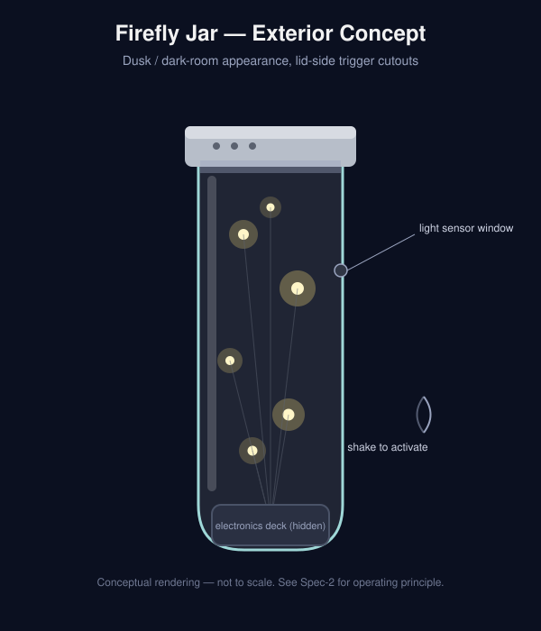
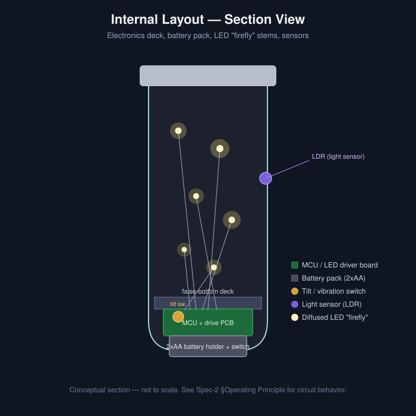
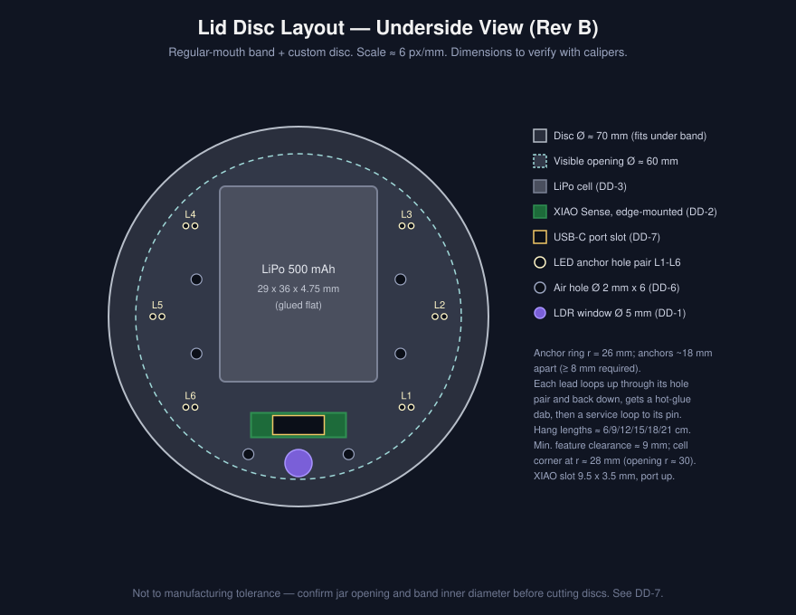
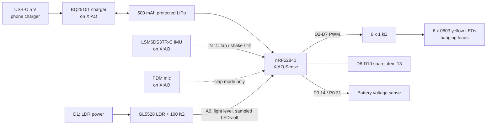
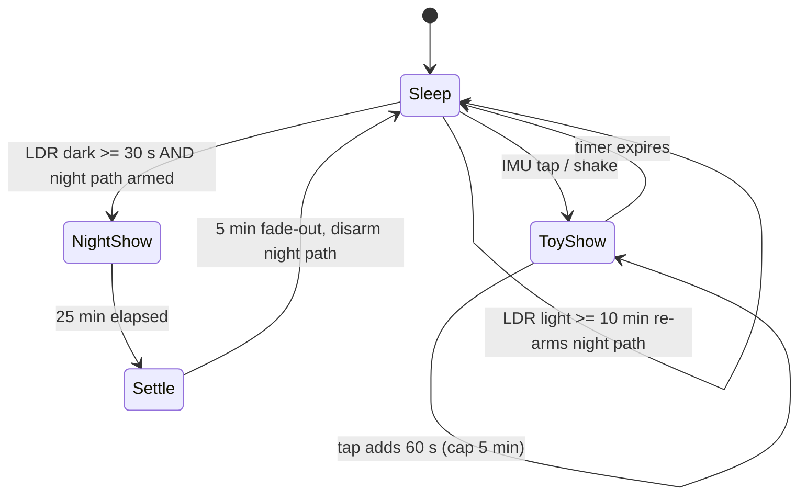
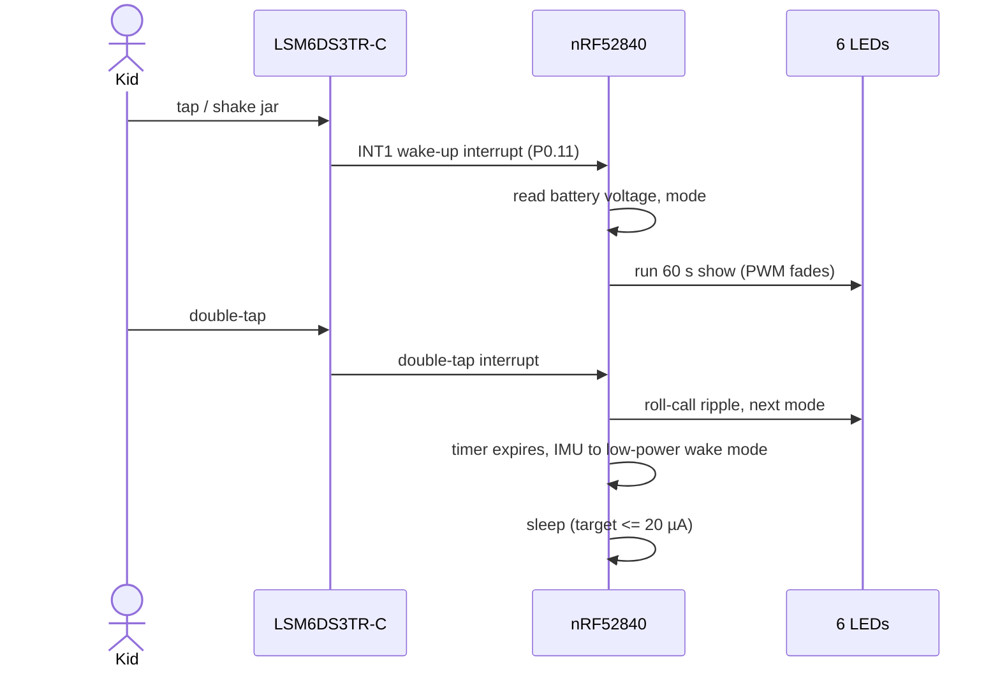

# Design Specification — Firefly Jar

| Asset | Revision | Status |
|---|---|---|
| [6080002](./6080002.md) | C | All design decisions DD-1 to DD-10 incorporated |

**Revision history**
- **A:** concept spec (ATtiny85, 2xAA, bottom deck, tilt switch + LDR).
- **B:** design decisions resolved; cost re-estimated.
- **C:** full specification restructured to the [Spec-1](./Spec-1.md) template; renderings redrawn to the top-hung lid layout; pin map, firmware parameters, assembly steps, test plan, and schedule added.

## Project Overview
The Firefly Jar is a handmade, battery-powered keepsake for **12 cousins aged 7-16**, to be delivered by **Christmas 2026**. Six tiny warm-yellow LEDs hang on near-invisible leads at staggered heights from the lid and fade in and out on a firefly-like rhythm. The jar is both:
- a **night light**: it comes alive for a 30-minute "dusk show" when the room goes dark, then the fireflies settle down to sleep;
- a **toy**: tap or shake it anytime to wake the fireflies and show people, and double-tap to switch modes.

All electronics live in the lid. Kids recharge it with any USB-C phone charger plugged into the top of the lid, about twice a year under typical use.

**Goals**, traced to [MuSCoW](../Define/MuSCoW.md):
- Look like real fireflies in a jar (item 1).
- Be safe and durable for the whole age range (items 14, 15, 17).
- Deliver lasting joy (item 12).
- Be buildable in ≤1 hour per unit (item 18).
- Stay within the item 3 budget rule.

### Renderings

*Exterior: lid with USB-C port, air holes, and light-sensor window; fireflies hang below; moss at the base.*

*Section: XIAO Sense on edge and LiPo under the lid disc; LEDs on hanging leads; no false bottom.*

*Lid disc underside, roughly to scale: cell, edge-mounted XIAO with USB-C slot, 6 LED anchor pairs, 6 air holes, LDR window.*

## Requirements

### Functional Requirements
| ID | Requirement | MuSCoW trace | Design decision |
|---|---|---|---|
| FR-1 | Display 6 independently faded point-light "fireflies" with a firefly-like cadence (~6 s, randomized offsets, call-and-response) | 1, 12 | [DD-4](./DD-4-LED-Type-and-Count.md), [DD-9](./DD-9-Glow-Pattern.md) |
| FR-2 | Start a 30-min night show after ≥30 s of darkness; final 5 min "settle down"; then disarm the night path until the room has been light ≥10 min | 6, 21 | [DD-1](./DD-1-Trigger-Mechanism.md), [DD-5](./DD-5-Glow-Cycle.md) |
| FR-3 | Wake on tap/shake at any time for a 60 s show; each extra tap adds 60 s, capped at 5 min | 4, 21 | [DD-1](./DD-1-Trigger-Mechanism.md), [DD-5](./DD-5-Glow-Cycle.md) |
| FR-4 | Combine wake sources with OR logic (dark OR tap/shake) | 10, 21 | [DD-1](./DD-1-Trigger-Mechanism.md) |
| FR-5 | Double-tap cycles modes: Meadow → Sync → Clap (stretch); a "roll call" ripple confirms each change | 7, 12 | [DD-9](./DD-9-Glow-Pattern.md) |
| FR-6 | Clap mode: mic active only while in mode; auto-exit after 2 min | 7 | [DD-1](./DD-1-Trigger-Mechanism.md), [DD-9](./DD-9-Glow-Pattern.md) |
| FR-7 | Tilt drift: flashes favor LEDs on the low side when the jar is tipped | 12 | [DD-9](./DD-9-Glow-Pattern.md) |
| FR-8 | "Sleepy fireflies" low-battery cue below ~3.5 V | 12, 19 | [DD-3](./DD-3-Power-Source.md), [DD-9](./DD-9-Glow-Pattern.md) |
| FR-9 | Recharge through a USB-C port on top of the lid, without tools or opening the jar | 2, 19 | [DD-3](./DD-3-Power-Source.md), [DD-7](./DD-7-LED-Stem-Mounting.md) |
| FR-10 | Reprogrammable over USB-C from Arduino IDE | 22 | [DD-2](./DD-2-Platform.md) |
| FR-11 | ≥2 spare PWM/GPIO outputs for future jar accessories | 13 | [DD-2](./DD-2-Platform.md), [DD-4](./DD-4-LED-Type-and-Count.md) |

### Non-Functional Requirements
Targets come from the [House of Quality](./House-of-Quality.md); verification is in [Testing](#testing).

| ID | Requirement | Target | MuSCoW trace |
|---|---|---|---|
| NFR-1 | Sleep (standby) current | ≤ 20 µA | 2 |
| NFR-2 | Runtime per charge, reference profile ([DD-3](./DD-3-Power-Source.md#reference-use-profile-and-battery-model)) | ≥ 180 days (model ~214) | 2, 19 |
| NFR-3 | Hands-on build time per unit | ≤ 60 min | 18 |
| NFR-4 | Hand solder joints per unit | ≤ 30 | 17, 18 |
| NFR-5 | Survive a 0.75 m drop onto carpet and repeated shaking with no functional loss | Pass | 15, 17 |
| NFR-6 | No coin cells, no exposed leads or sharp ends; PET jar for ages ≤12 | Pass inspection | 14, 15 |
| NFR-7 | Unit parts cost | ≤ $20 easy yes; above that, justified per item 3 (Rev C ~$30) | 3 |
| NFR-8 | Unwanted wakes (not caused by a person or dusk) | ≤ 1 per night | 21, 23 |
| NFR-9 | All 12 units built, tested, and ready | by Dec 20, 2026 | 16, 20 |

## Design

### Architecture

### Pin Map (XIAO nRF52840 Sense)
| XIAO pin | Function | Notes |
|---|---|---|
| D0 / A0 | LDR sense (analog) | Divider midpoint; sampled ~every 10 s for 50 ms with all LEDs off |
| D1 | LDR power | Driven high only while sampling, so the divider draws ~0 µA otherwise |
| D2 | LED 1 (hang ~6 cm) | PWM, via 1 kΩ to LED anode; cathodes to GND |
| D3 | LED 2 (~9 cm) | PWM |
| D4 | LED 3 (~12 cm) | PWM |
| D5 | LED 4 (~15 cm) | PWM |
| D6 | LED 5 (~18 cm) | PWM |
| D7 | LED 6 (~21 cm) | PWM |
| D8, D9, D10 | Spare | Item 13 accessories or a "+2 fireflies" upgrade ([DD-4](./DD-4-LED-Type-and-Count.md)) |
| Internal P1.08 / P0.11 | IMU power / IMU INT1 | Per [Seeed wiki](https://wiki.seeedstudio.com/XIAO_BLE/) |
| Internal P0.14 / P0.31 | Battery-read enable / ADC | Keep P0.14 low when reading; don't set high while charging |
| Internal P0.13 | Charge-current select | Set for 100 mA charging |
| Internal P0.16 / P1.00 | PDM mic data / clock | Clap mode only |
| BAT+ / BAT− pads | LiPo via JST-PH pigtail | Cell replaceable |

LED drive: (3.3 V − ~2.0 V Vf) / 1 kΩ ≈ 1.3 mA peak, and ≈ 2.8 mA with 470 Ω if brighter is needed. The battery model assumes ~2 mA peak.

### Behavior (state machine)

Double-tap during any show cycles the mode ([DD-9](./DD-9-Glow-Pattern.md)). Tilt drift and the low-battery cue apply in every mode.

### Wake Sequence

### Components
Bill of materials per unit at qty 12. Items marked (est.) are not yet price-checked.

| Ref | Part | Source / P/N | Qty / unit | Est. cost / unit | Decision |
|---|---|---|---|---|---|
| U1 | Seeed XIAO nRF52840 Sense | Mouser 713-102010469 | 1 | $15.90 | [DD-2](./DD-2-Platform.md) |
| BT1 | LiPo 3.7 V 500 mAh, protected, JST-PH | Adafruit #1578 | 1 | $7.16 | [DD-3](./DD-3-Power-Source.md) |
| J1 | JST-PH 2-pin pigtail (to BAT pads) | Adafruit / Amazon (est.) | 1 | $0.35 | [DD-3](./DD-3-Power-Source.md) |
| LDR1, R7 | GL5528 LDR + 100 kΩ resistor | Any (est.) | 1 set | $0.15 | [DD-1](./DD-1-Trigger-Mechanism.md) |
| D1-D6 | Pre-wired 0603 3 V LED, yellow, 30 cm | [eBay 227363613241](https://www.ebay.com/itm/227363613241), $32.99/100 incl. ship | 6 | $1.98 | [DD-4](./DD-4-LED-Type-and-Count.md), [DD-8](./DD-8-LED-Color.md) |
| R1-R6 | 1 kΩ 1/4 W resistors + hookup wire | Kit share (est.) | 6 | $0.30 | [DD-4](./DD-4-LED-Type-and-Count.md) |
| — | Jar: PET (≤12 yrs, ~$3.12) or Ball glass pint (13-16, $1.12) | Walmart / HEB listings | 1 | $2.12 avg (6/6 split assumed) | [DD-10](./DD-10-Enclosure.md) |
| — | Custom lid disc (plywood/acrylic/printed) + jar's own band | Shop-made (est.) | 1 | $0.50 | [DD-7](./DD-7-LED-Stem-Mounting.md) |
| — | Frosted vellum/tissue liner | Craft store (est.) | 1 | $0.20 | [DD-10](./DD-10-Enclosure.md) |
| — | Preserved moss + hot glue | Craft store, ~$16 shared | — | $1.33 | [DD-6](./DD-6-Lid-Vent.md) |
| | **Total** | | | **~$29.99 (~$360 for 12)** | |

**Item 3 assessment.** This is ~$19/unit (~$229 total) above the recomputed Rev A concept (~$10.90/unit) and above the $20 easy-yes line. Per the item 3 rule, the spend buys:
- **Joy (item 12):** IMU tap/double-tap modes, sync and clap modes, tilt drift, sleepy-firefly cue.
- **Build time (item 18):** est. 30-40 min saved per jar.
- **Tool-free charging (item 19).**
- **Reprogramming (item 22)** and **3 spare PWM pins (item 13).**

Weighted requirement satisfaction rises from 60% to 87% ([House of Quality](./House-of-Quality.md#concept-comparison-planning-matrix)). Not included: 2 spare platform sets (~$47), shipping, tools, and the optional per-gift USB-C cable.

### Data Model (firmware configuration)
All behavior is set by named constants at the top of the sketch, so it can be tuned after Destroy and edited by a reprogramming cousin (item 22).

| Constant | Default | Unit | Source |
|---|---|---|---|
| `NIGHT_SHOW_MIN` | 30 | min | [DD-5](./DD-5-Glow-Cycle.md) |
| `SETTLE_MIN` | 5 | min (inside the night show) | [DD-5](./DD-5-Glow-Cycle.md) |
| `DARK_CONFIRM_S` | 30 | s | [DD-5](./DD-5-Glow-Cycle.md) |
| `REARM_LIGHT_MIN` | 10 | min | [DD-5](./DD-5-Glow-Cycle.md) |
| `TOY_SHOW_S` / `TOY_MAX_S` | 60 / 300 | s | [DD-5](./DD-5-Glow-Cycle.md) |
| `LDR_SAMPLE_S` | 10 | s | [DD-1](./DD-1-Trigger-Mechanism.md) |
| `LDR_DARK` / `LDR_LIGHT` | set in Destroy | ADC counts (hysteresis pair) | [DD-1](./DD-1-Trigger-Mechanism.md) |
| `FLASH_PERIOD_S` | 5.9 ± 0.6 | s | [DD-9](./DD-9-Glow-Pattern.md) addendum, [6080015](../Develop/DevNote-Courtship-Sequence.md) |
| `PULSE_RISE_MS` / `PULSE_FALL_MS` | 150 / 350 | ms | Male and female flash shape; supersedes `FADE_MS`. [6080015](../Develop/DevNote-Courtship-Sequence.md) |
| `J_DIP_LEVEL` | 0.30 | fraction | Lower LED's peak during the male's dip. [6080015](../Develop/DevNote-Courtship-Sequence.md) |
| `J_HANDOFF_MS` | 100 | ms | Delay before the upper LED starts rising. [6080015](../Develop/DevNote-Courtship-Sequence.md) |
| `LANDING_LEVEL` | 0.60 | fraction | Final single-LED "landing" flash ending a courtship. [6080015](../Develop/DevNote-Courtship-Sequence.md) |
| `FEMALE_LED` | 6 | LED index | Always the lowest-hanging LED. [6080015](../Develop/DevNote-Courtship-Sequence.md) |
| `FEMALE_GAIN` | 0.10 | fraction | Female peak relative to male; check against actual LED/resistor once the prototype is lit. [6080015](../Develop/DevNote-Courtship-Sequence.md) |
| `ANSWER_DELAY_MS` | 2100 ± 200 | ms | Measured from the courting male's **peak**, not onset. [6080015](../Develop/DevNote-Courtship-Sequence.md) |
| `MALE_SPACING_MIN_S` | 3.5 | s | Minimum time between one LED's own flashes. [6080015](../Develop/DevNote-Courtship-Sequence.md) |
| `COURTSHIP_EVERY_S` | 60-120 | s | Random interval between courtship micro-events inside Meadow. [6080015](../Develop/DevNote-Courtship-Sequence.md) |
| `PAIR_REST_S` | 15-30 | s | Rest after a courtship exchange ends. [6080015](../Develop/DevNote-Courtship-Sequence.md) |
| `SYNC_CONVERGE_S` | 60 | s | [DD-9](./DD-9-Glow-Pattern.md) |
| `CLAP_MODE_S` | 120 | s | [DD-1](./DD-1-Trigger-Mechanism.md) |
| `IMU_WAKE_THRESHOLD` | set in Destroy (gentle tap) | mg | [DD-1](./DD-1-Trigger-Mechanism.md) |
| `LOW_BATT_V` | 3.5 | V | [DD-3](./DD-3-Power-Source.md) |
| `LED_PINS[]` | D2-D7 | — | Pin map |

## Implementation

### Technologies
- **MCU:** Nordic nRF52840 (Arm Cortex-M4F) on the Seeed XIAO nRF52840 Sense.
  - Hardware PWM for fades.
  - IMU interrupts for wake.
  - System ON sleep with the RTC for LDR sampling.
- **Firmware:** Arduino (C++) using Seeed's nRF52 board support ([Seeed wiki](https://wiki.seeedstudio.com/XIAO_BLE/)).
  - Pick whichever Seeed core variant meets the ≤20 µA sleep target in the first Destroy test.
  - Low-power settings: UART/USB serial off in sleep, QSPI flash deep power-down, gyro off, accelerometer in low-power 12.5 Hz wake mode.
- **Power:** single-cell protected LiPo; the on-board BQ25101 charges at 100 mA.

### Tools
- Arduino IDE.
- Nordic Power Profiler Kit II or a µA-range multimeter (sleep-current verification).
- Fine-tip soldering iron and flux.
- Drill with 1.5-2 mm bits; scroll saw or laser/3D printer for the lid discs.
- Hot-glue gun, calipers, frosting liner materials.

### Assembly Procedure (per jar)
Target ≤60 min; time the first unit.
1. Cut the lid disc. Drill the USB-C slot, LDR window, 6 anchor-hole pairs, and 6 air holes per the [layout](Spec-2-media/lid-disc-layout.svg).
2. Flash and test the XIAO firmware over USB before assembly.
3. Solder the 6 resistors to D2-D7. Solder the LDR and 100 kΩ divider to D0/D1/GND. Solder the JST pigtail to the BAT pads.
4. Thread each LED lead up and back through its anchor pair and set its hang length (~6/9/12/15/18/21 cm). Solder the anodes to the resistors and the common cathodes to GND. Add a hot-glue dab at each anchor.
5. Mount the XIAO on edge with USB-C through the slot, and glue the LiPo flat. Connect the battery.
6. Function check: tap wake, double-tap mode change, cover the LDR for the night show, then charge.
7. Fit the liner and moss in the jar, insert the lid assembly, and tighten the band.

## Testing

### Test Plan
Every prototype test must pass before ordering the remaining 11 XIAO boards. Batch tests run on all 12 units.

| Test | Verifies | Method | Pass criterion | When |
|---|---|---|---|---|
| TC-FJ-01 Sleep current | NFR-1 | PPK2 / µA meter on battery lead, IMU armed, LDR sampling | ≤ 20 µA average | Prototype, before ordering 11 more boards |
| TC-FJ-02 Active current | NFR-2 | Measure average during a Meadow show | ≤ 3 mA | Prototype |
| TC-FJ-03 Runtime projection | NFR-2 | Compute from TC-01/02 with the DD-3 profile | ≥ 180 days | Prototype |
| TC-FJ-04 Build time and joints | NFR-3, NFR-4 | Stopwatch and joint count on the first unit | ≤ 60 min, ≤ 30 joints | Prototype |
| TC-FJ-05 Night show | FR-2 | Dark room; observe start, 30 min run, settle, no restart until light ≥ 10 min | As specified | Prototype |
| TC-FJ-06 Toy wake | FR-3, FR-4 | Gentle tap, shake, stacked taps | Wakes reliably; 60 s per tap; 5 min cap | Prototype + batch |
| TC-FJ-07 Modes and cues | FR-5 to FR-8 | Double-tap cycle; tilt; clap; low-battery via bench supply at 3.4 V | All behave as specified | Prototype |
| TC-FJ-08 Unwanted wakes | NFR-8 | Overnight in a bedroom, log wakes | ≤ 1 unexplained wake per night | Prototype |
| TC-FJ-09 Drop and shake | NFR-5 | 10 x 0.75 m drops onto carpet (PET and glass); 1,000 shakes | No breakage; all LEDs and joints work | Prototype (one of each jar type) |
| TC-FJ-10 Charging | FR-9 | Charge from empty with a phone charger; feel lid temperature | Completes in ≤ 7 h; lid only slightly warm | Prototype + batch |
| TC-FJ-11 Safety inspection | NFR-6 | Check for exposed leads, sharp ends, secure cell, correct jar for age | Pass | Batch, all 12 |
| TC-FJ-12 Reflash | FR-10 | Upload firmware over USB-C | Succeeds | Batch, all 12 |

### Test Cases
Detailed procedures go in [Destroy/TestCases](../Destroy/TestCases/) using the [TC-EXAMPLE](../Destroy/TestCases/TC-EXAMPLE.md) format, with execution records in a test cycle folder.

## Deployment

### Deployment Plan
| Date (2026) | Milestone |
|---|---|
| By Oct 31 | Order 1 prototype XIAO Sense (plus LiPo, LEDs, LDRs, one PET and one glass test jar); confirm cousin age split |
| By Nov 15 | Prototype built; TC-FJ-01 to 10 executed; constants tuned |
| Nov 16 | Order the remaining 11 XIAO boards + 2 spares (or the fallback platform, see rollback) and all jars |
| Nov 26-29 (Thanksgiving weekend) | Batch build of 12 units |
| Dec 1-15 | Batch tests TC-FJ-06, 10, 11, 12; 3-day soak test |
| By Dec 20 | Wrap with a charging card for parents; ready to give |

### Rollback Plan
| If... | Fall back to |
|---|---|
| Sleep current can't reach ≤20 µA on the XIAO Sense | Plain XIAO nRF52840 + spring vibration switch ([DD-2](./DD-2-Platform.md) rank 2, [DD-1](./DD-1-Trigger-Mechanism.md) rank 3) |
| XIAO stock runs out | XIAO Sense Plus (Mouser 713-102010694) |
| Pre-wired LEDs are late or the wrong color | Bare 0603 LEDs on magnet wire ([DD-4](./DD-4-LED-Type-and-Count.md) rank 3), with DigiKey/Mouser domestic stock |
| PET jar doesn't take a regular-mouth band | All-PET with a second disc size, or glass + sleeve ([DD-10](./DD-10-Enclosure.md)) |
| Firmware is behind schedule | Ship the Must-ship set (Meadow, settle, low-battery) and offer a USB update later ([DD-9](./DD-9-Glow-Pattern.md)) |

## Maintenance

### Monitoring
- The "sleepy fireflies" cue tells the owner to charge.
- The XIAO's charge LED shows charging status.
- No other monitoring.

### Updates
- Firmware lives in this repo (Develop). Updates are reflashed over USB-C, by the owner at a family visit or by a teen cousin (item 22).
- The JST connector makes the cell replaceable after several years.

## Design Decisions
| Asset | Decision | Selected option (rank 1) |
|---|---|---|
| [6080003](./6080003.md) | [DD-1](./DD-1-Trigger-Mechanism.md) Triggering mechanism(s) | LDR OR accelerometer; mic as opt-in clap mode |
| [6080004](./6080004.md) | [DD-2](./DD-2-Platform.md) Electronics platform | XIAO nRF52840 Sense |
| [6080005](./6080005.md) | [DD-3](./DD-3-Power-Source.md) Power source | 500 mAh protected LiPo, USB-C via XIAO |
| [6080006](./6080006.md) | [DD-4](./DD-4-LED-Type-and-Count.md) LED type and count | 6 pre-wired 0603 3 V LEDs |
| [6080007](./6080007.md) | [DD-5](./DD-5-Glow-Cycle.md) Glow-cycle timing | 30 min night show w/ settle; 60 s toy, stackable to 5 min |
| [6080008](./6080008.md) | [DD-6](./DD-6-Lid-Vent.md) Lid venting | 6 small "air holes"; dry moss only |
| [6080009](./6080009.md) | [DD-7](./DD-7-LED-Stem-Mounting.md) LED mounting / electronics location | Top-hung from custom lid disc; USB-C up |
| [6080010](./6080010.md) | [DD-8](./DD-8-LED-Color.md) LED color | Yellow; warm white optional |
| [6080011](./6080011.md) | [DD-9](./DD-9-Glow-Pattern.md) Glow pattern and modes | Meadow → Sync → Clap + cues |
| [6080012](./6080012.md) | [DD-10](./DD-10-Enclosure.md) Enclosure | PET ≤12 yrs, glass 13-16, same lid |

## Open Items
- Confirm the cousin age split (sets the PET/glass count).
- Confirm the PET jar accepts a regular-mouth band, and measure the jar opening and band inner diameter with calipers before cutting discs.
- Run TC-FJ-01 (sleep current) before ordering the remaining boards.

## Appendix
- [MuSCoW requirements](../Define/MuSCoW.md)
- [House of Quality](./House-of-Quality.md)
- [Design decision template](./decision-template.md)
- [Seeed Studio XIAO nRF52840 Series wiki](https://wiki.seeedstudio.com/XIAO_BLE/)
- [Adafruit 500 mAh LiPo #1578](https://www.adafruit.com/product/1578)
- [Seeed forum: XIAO Sense IMU current and measured sleep](https://forum.seeedstudio.com/t/xiao-ble-sense-lsm6ds3-int1-single-tap-interrupt/264206?page=2)
