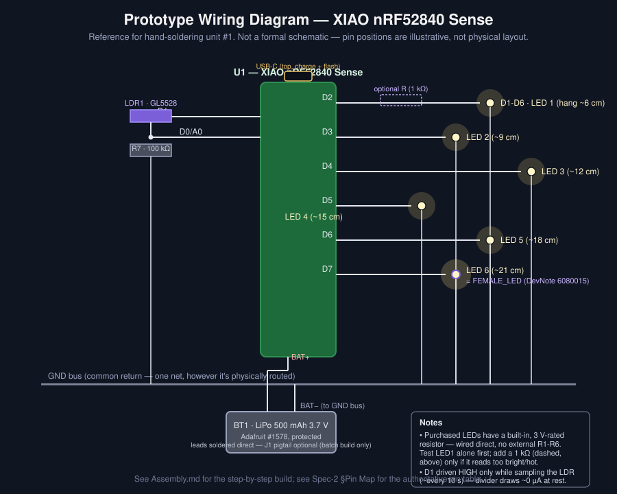

# Prototype Assembly Drawings

**Asset:** [6080016](./6080016.md) · Build reference for unit #1 (the prototype), alongside [Spec-2's text assembly procedure](../Design/Spec-2.md#assembly-procedure-per-jar) and the existing [lid disc layout](../Design/Spec-2-media/lid-disc-layout.svg). This doc adds the one drawing that was missing — an actual wiring reference — and a prototype-specific build checklist that accounts for what actually got purchased (see the [2026-10-10 meeting](./Meetings/2026-10-10-Prototype-Parts-Order.md)).

## Wiring Diagram

This is the diagram Spec-2's pin-map *table* and architecture *flowchart* don't give you: what actually gets soldered to what. Reference designators match [Spec-2's Components table](../Design/Spec-2.md#components) (U1, BT1, LDR1, R7, D1-D6).

**One deliberate deviation from the original BOM, reflected in this drawing:** the LEDs actually purchased ([meeting note](./Meetings/2026-10-10-Prototype-Parts-Order.md#6-owners-and-dates), Amazon-sourced) have a resistor **built into the lead assembly**, rated for 3 V operation — unlike [DD-4](../Design/DD-4-LED-Type-and-Count.md)'s selected part (bare pre-wired 0603, no resistor, relying on the external 1 kΩ R1-R6). A pre-wired LED explicitly built and labeled for 3 V operation is, by construction, meant to be driven directly from a 3.3 V logic pin — that's the entire purpose of building the resistor in. **So this diagram wires D2-D7 straight to each LED, no external R1-R6.** Verify this is right before committing to all six:

1. Wire **one** LED (LED 1, on D2) and run [`01_bringup_test.ino`](./Firmware/01_bringup_test/01_bringup_test.ino).
2. Measure current in series, or estimate from the voltage drop across the LED. Should land well under the GPIO's 4 mA standard-drive ceiling (see the resistor discussion in the [2026-10-10 meeting](./Meetings/2026-10-10-Prototype-Parts-Order.md#resistor-value-review-r1-r6-r7) — the built-in resistor almost certainly already limits current to a sane value for a 3 V-rated part).
3. If it reads unexpectedly bright, hot, or you can't get a current reading that makes sense, **stop and add an external 1 kΩ** (the dashed symbol in the diagram) before wiring the rest. R1-R6 stay in the [BOM](./BOM.md) as a fallback either way.

The **battery** is wired straight to the board's bottom-side pads for the prototype (on-hand hookup wire substitutes for the BOM's J1 JST-PH pigtail) — simplest for one unit. **Correction from inspecting the actual board:** those pads are silkscreened **VIN** and **GND**, not BAT+/BAT− as Spec-2's pin map assumed — same function (battery input), different label. The wiring diagram and this doc now use the real labels. J1 remains worthwhile for the batch build, where tool-free cell replacement years from now matters more than one extra joint today (ties to [meeting action item 4](./Meetings/2026-10-10-Prototype-Parts-Order.md#action-items)).

One more confirmed-from-the-schematic detail, useful if the board ever sits near anything conductive: the USB-C connector's metal shell is tied to the same GND net as everything else on the board (no isolated chassis ground) — checked directly against [Seeed's XIAO nRF52840 schematic](https://files.seeedstudio.com/wiki/XIAO-BLE/Seeed_Studio_XIAO_nRF52840_PDF.pdf). Worth remembering since the USB-C port sits right at the lid surface, close to the jar's metal screw band.

### Ground Bus (hand-soldering technique)

Six LED cathodes, the LDR's R7 ground leg, and the board's GND all need to land on one common return. For hand assembly, **run a single bare/tinned solid-core spine wire, not individual wires back to one point**:

1. Cut one length of solid-core hookup wire (easier to shape and tack down than stranded) long enough to loosely trace the same ring the LED anchor holes sit on — they're already ~18 mm apart on a 26 mm-radius ring per the [lid disc layout](../Design/Spec-2-media/lid-disc-layout.svg), so every LED's cathode is a short hop from the spine.
2. **Tack the spine down with a couple of hot-glue dots before soldering anything to it.** Soldering into an already-anchored wire is far easier than retrofitting a bus into a lid that's already full of LEDs.
3. As each LED gets threaded and anchored (build step 5 below), solder its cathode to the nearest point on the spine. Same for the LDR's R7 ground leg.
4. Land one end of the spine on the XIAO's **top-header GND pin** (next to 5V/3V3 — same side as D2-D7, convenient). The battery's GND goes separately to the **bottom GND pad**; different physical spot, same net, so this isn't a conflict.
5. That's 8 ground joints total (6 LEDs + LDR + XIAO) — no more than individual runs would need, just shorter wire and far less clutter in a ~70 mm lid.
6. **Safety:** slip a short length of heat-shrink over the spine between joints, or at minimum keep it dressed away from the jar's metal screw band — a stray flex shorting bare ground wire against a grounded metal band isn't itself dangerous (it's already GND), but it's still worth keeping tidy and away from anything it could abrade against over years of handling.

### Mounting the XIAO ("on edge")

[DD-7](../Design/DD-7-LED-Stem-Mounting.md) calls for the board mounted **on edge** — standing vertically, perpendicular to the disc, not lying flat — so its USB-C end pokes up through the slot. That's trickier to glue well than a flat board, so:

- **The slot does some of the work for you.** The board (17.5 mm wide) is wider than the USB-C slot (9.5 mm), so its body can't pass through — the shoulders around the connector rest against the disc's underside. That contact is what actually resists plug-in force; the glue mainly needs to keep the board upright, not fight every charging cycle.
- **Don't glue the bare PCB edge straight to the flat disc** — a thin edge has almost no contact area and will eventually let go. Instead, cut two small flat fence pieces (scrap disc material, or stiff cardboard), dry-fit the board through the slot to confirm the port sits flush and a cable actually plugs in cleanly, then glue the fences standing up snug against each flat face of the board. That gives broad face-to-face contact instead of a weak edge-on bond.
- **Use a stronger adhesive for this one joint than the hot glue used elsewhere.** The LED anchors and moss are static; this joint takes repeated insertion force every charge, for years. 5-minute epoxy (or a craft adhesive like E6000) holds up to that better than hot glue. Let it fully cure — not just the 5-minute workable stage — before the first charge test.
- **Do this before the LiPo goes in beside it.** Confirm the board's final position and test-plug a cable while there's still clear access, since the battery sits flat right next to it afterward.

## Lid Disc Layout

Unchanged from Design — see [Spec-2-media/lid-disc-layout.svg](../Design/Spec-2-media/lid-disc-layout.svg) for hole positions (USB-C slot, LDR window, 6 LED anchor-hole pairs, 6 air holes) and the anchor ring dimensions. **Measure the actual jar opening and band inner diameter with calipers before cutting** — this drawing is explicitly "not to manufacturing tolerance" per its own footer, and [DD-10](../Design/DD-10-Enclosure.md)/[Spec-2's Open Items](../Design/Spec-2.md#open-items) still flag the PET jar's band fit as unverified.

## Prototype Build Checklist

Spec-2's 7-step procedure is written for the batch (12 units, ≤60 min each). For the prototype, work through it in this order, with the verification gates a one-off build actually needs:

| # | Step | Note for the prototype |
|---|---|---|
| 1 | Cut the lid disc per the [layout](../Design/Spec-2-media/lid-disc-layout.svg) | Use whichever jar (PET or glass) is on hand for a test fit — the final age-split decision ([meeting item 1](./Meetings/2026-10-10-Prototype-Parts-Order.md#1-cousin-age-split-pet-vs-glass)) doesn't block this |
| 2 | Flash [`01_bringup_test.ino`](./Firmware/01_bringup_test/01_bringup_test.ino) over USB **before any soldering** | Confirms the board, the Arduino IDE board-support setup, and USB-C flashing all work first — cheapest point to catch a dead board |
| 3 | Solder LED 1 only (D2) per the wiring diagram above | Do the current check above before going further |
| 4 | Solder the LDR + R7 divider to D0/D1/GND | Re-run `01_bringup_test.ino`; confirm the Serial Monitor shows a sensible analog reading that changes when you cover the LDR |
| 5 | Solder LEDs 2-6 and the battery leads | Thread each lead through its anchor pair at the hang length called out on the wiring diagram (6/9/12/15/18/21 cm) before soldering; tack down and solder the [ground bus](#ground-bus-hand-soldering-technique) as you go, not after |
| 6 | Mount the XIAO on edge with USB-C through the slot; glue the LiPo flat; connect the battery | See [Mounting the XIAO](#mounting-the-xiao-on-edge) — the board's position needs confirming before the LiPo goes in beside it |
| 7 | Flash [`02_courtship_demo.ino`](./Firmware/02_courtship_demo/02_courtship_demo.ino) and function-check | See [Test Code](#test-code) below |
| 8 | Fit the liner and moss, insert the lid assembly, tighten the band | |

## Test Code

Two sketches in [Develop/Firmware](./Firmware/), both for the XIAO nRF52840 Sense (Arduino IDE, Seeed's nRF52 board support — see [Spec-2 Implementation](../Design/Spec-2.md#technologies)):

| Sketch | Purpose | Status |
|---|---|---|
| [`01_bringup_test.ino`](./Firmware/01_bringup_test/01_bringup_test.ino) | Hardware verification: steps each LED individually, prints raw LDR readings, prints battery voltage over Serial. Run this first, before trusting any soldered joint. | Ready to flash |
| [`02_courtship_demo.ino`](./Firmware/02_courtship_demo/02_courtship_demo.ino) | Implements the Meadow background cadence plus the courtship micro-event from [DevNote 6080015](./DevNote-Courtship-Sequence.md) (now the project's reconciled model — see the [DD-9 addendum](../Design/DD-9-Glow-Pattern.md)). | Ready to flash — see the file's own header comment for what's deliberately **not** included yet |

Neither sketch implements IMU wake/sleep power management, the night-light/toy state machine (FR-2 through FR-4), mode-cycling via double-tap, or the low-battery cue — those need the Seeed IMU library integrated and tuned against real sleep-current measurements (TC-FJ-01), which is Destroy-phase work, not something to guess at from here. `02_courtship_demo.ino` runs Meadow continuously over USB power so you can watch the courtship sequence and tune `PULSE_RISE_MS` / `J_HANDOFF_MS` / `FEMALE_GAIN` against the real LEDs before those constants get locked into the full state machine.
